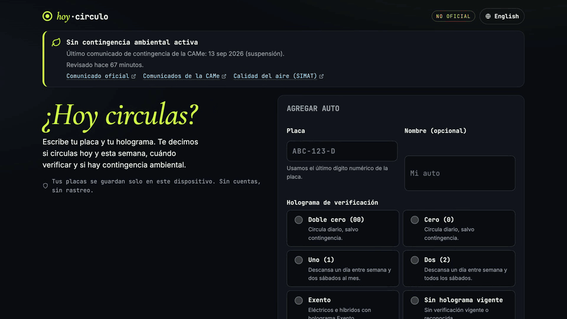
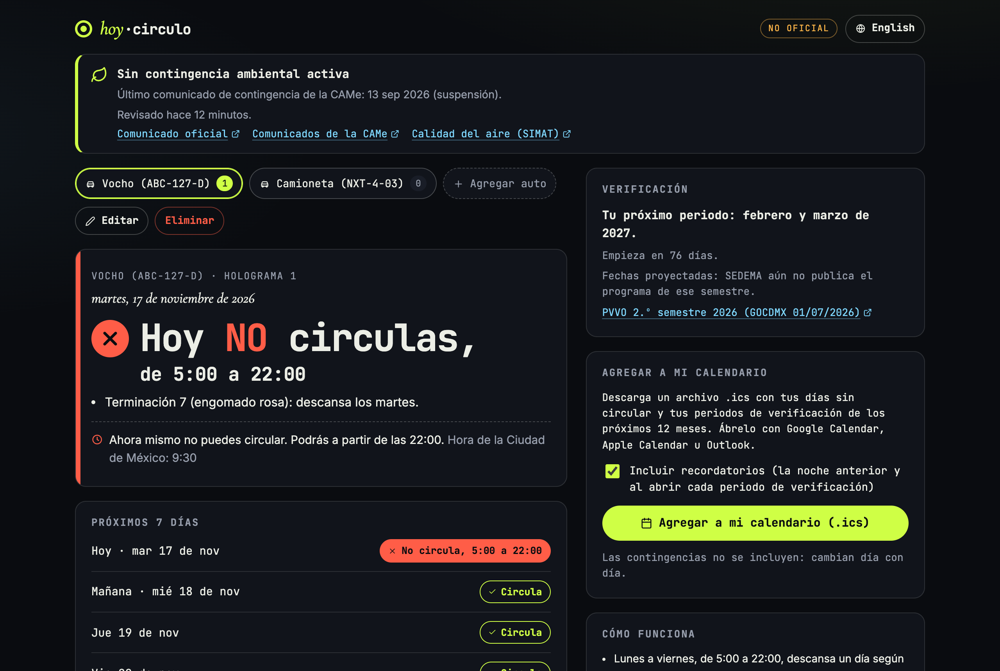
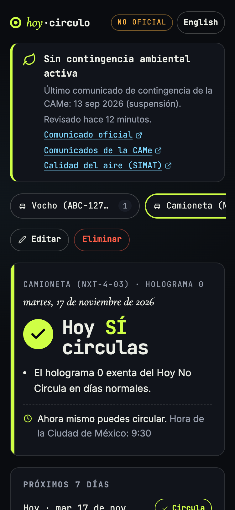
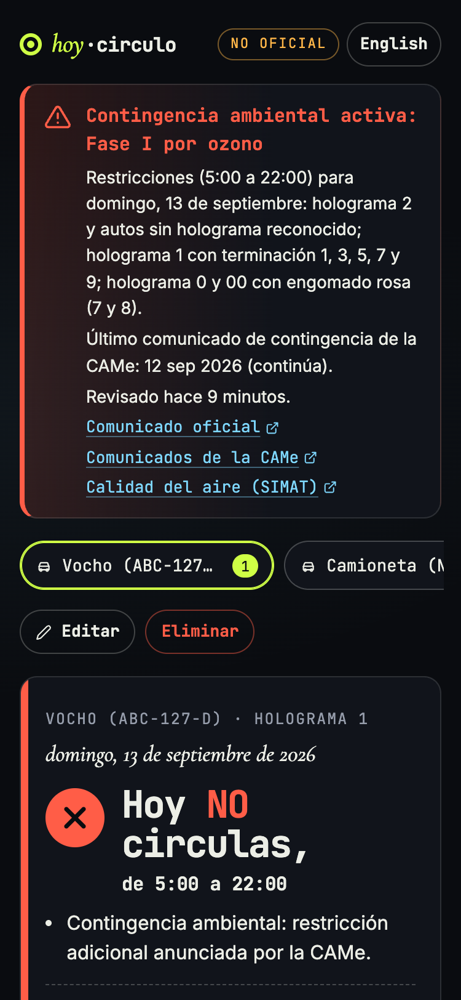
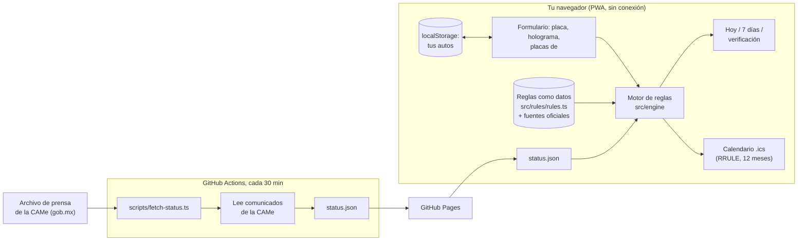

<p align="center">
  
</p>

<p align="center">
  <a href="https://github.com/BEG-lag/hoy-circulo/actions/workflows/ci.yml"></a>
  <a href="https://github.com/BEG-lag/hoy-circulo/actions/workflows/deploy.yml"></a>
  <a href="LICENSE"></a>
  
</p>

<p align="center"><a href="README.md">English</a> · <b>Español</b></p>

<!-- demo:start -->
<p align="center">
  
</p>
<p align="center"><sub>Grabación real de <a href="https://beg-lag.github.io/hoy-circulo/">la app en vivo</a> el 2026-11-17. <a href="assets/demo.mp4">Versión MP4</a>.</sub></p>
<!-- demo:end -->

# hoy·circulo

**¿Hoy circulas?** Una aplicación web pequeña e instalable para quienes manejan en la Ciudad de México y el Estado de México: escribes tu placa y tu holograma y te dice si circulas hoy y esta semana según el *Hoy No Circula*, te avisa de contingencias ambientales, te muestra tu próximo periodo de verificación y lo manda todo al calendario de tu teléfono (.ics).

**Úsala:** https://beg-lag.github.io/hoy-circulo/ (en español, con opción en inglés).

> **No oficial. Consulta los avisos oficiales de SEDEMA y la CAMe.** Es una herramienta independiente, no un servicio de gobierno, y no constituye opinión legal. Si un aviso oficial dice algo distinto, manda el aviso.

| Escritorio | Teléfono | Contingencia (13 sep 2026, reproducida) |
|---|---|---|
|  |  |  |

## Qué hace

- **Respuesta grande y clara.** "Hoy SÍ circulas" u "Hoy NO circulas, de 5:00 a 22:00", con el motivo (engomado, regla de sábados, placas foráneas, contingencia) y qué significa ahora mismo, en hora de la Ciudad de México.
- **Los próximos 7 días**, con sábados según la semana del mes, quintos sábados y días festivos (el programa no se suspende en festivos salvo aviso oficial).
- **Aviso de contingencia ambiental** alimentado por los comunicados oficiales de la CAMe (ver [estado en vivo](#estado-de-contingencia-en-vivo)). Si no se puede confirmar, lo dice y te manda al anuncio oficial en vez de adivinar.
- **Próximo periodo de verificación** según tu engomado, con las fechas proyectadas marcadas cuando la SEDEMA aún no publica el programa de ese semestre.
- **Agregar a mi calendario:** un archivo .ics con eventos recurrentes (RRULE) de los días sin circular y los periodos de verificación de los próximos 12 meses, con recordatorios opcionales. Funciona con Google Calendar, Apple Calendar y Outlook.
- **Varios autos**, guardados solo en tu navegador (localStorage). Sin cuentas, sin servidor, sin analítica, sin cookies, sin peticiones a terceros (las fuentes tipográficas van incluidas).
- **PWA instalable** que funciona sin conexión después de la primera visita.
- **Accesible:** controles con etiqueta, uso con teclado, foco visible, el color nunca es la única señal (cada estado tiene texto e ícono), sin desplazamiento horizontal a 375 px, respeta `prefers-reduced-motion`.

## Cómo funciona



Las reglas son datos con sus fuentes ([`src/rules/rules.ts`](src/rules/rules.ts), [`src/rules/sources.ts`](src/rules/sources.ts)). El motor ([`src/engine/hnc.ts`](src/engine/hnc.ts)) solo lee esos datos: un programa de verificación nuevo o un aviso de suspensión es un cambio de datos, no de código.

## Las reglas, en corto

Cada regla se leyó en los documentos oficiales el 17 de noviembre de 2026. Numerales, citas y lo que no se pudo verificar están en **[docs/reglas.md](docs/reglas.md)**.

| Regla | Fuente |
|---|---|
| Lunes a viernes, de 5:00 a 22:00, un día según el último dígito: 5 y 6 lunes, 7 y 8 martes, 3 y 4 miércoles, 1 y 2 jueves, 9 y 0 viernes | [Decreto HNC, GODF 19/06/2014](https://www.sedema.cdmx.gob.mx/storage/app/media/programas/hoy-no-circula/decreto-programa-hoy-no-circula-segundo-semestre-2016.pdf), tablas 1 y 2 |
| Holograma 1: terminación impar descansa el 1.er y 3.er sábado; par, el 2.º y 4.º; el 5.º sábado circula | Decreto HNC 2014, tabla 1; [PVVO 2.º semestre 2026, GOCDMX 01/07/2026](https://proyectos.sedema.cdmx.gob.mx/datos/storage/app/media/gacetas/GOCDMX_26-07-01_DGCA.pdf), 14.2 fr. I |
| Holograma 2 y autos sin holograma vigente: todos los sábados | Decreto HNC 2014, tabla 2; PVVO 2026, 14.2 fr. II y V |
| Hologramas 00, 0, Exento (eléctricos e híbridos), placas para personas con discapacidad, Pase Turístico: exentos en días normales | PVVO 2026, 14.1 |
| Placas de otros estados o extranjeras sin holograma reconocido: como holograma 2, más de lunes a viernes de 5:00 a 11:00 | Decreto HNC 2014, V y tabla 3; PVVO 2026, 14.2 fr. IV |
| Días festivos: el programa sí aplica salvo aviso oficial de suspensión | Decreto HNC 2014, XI |
| Dónde: 16 alcaldías de la CDMX y 18 municipios del Estado de México | [Guía de la CAMe](https://www.gob.mx/cms/uploads/attachment/file/878737/Guia_del_Programa_HNC_02_enero_2024.pdf) |
| Verificación: dos meses por semestre según el engomado | [PVVO 1.er semestre 2026](https://proyectos.sedema.cdmx.gob.mx/datos/storage/app/media/gacetas/GOCDMX_26-01-02_DGCA.pdf) y 2.º semestre 2026, tabla 1 |
| Contingencia Fase I o II: holograma 2 todos; holograma 1 par o non (alternado, según el comunicado); 0 y 00 por el engomado del día | [Programa de Contingencias, GOCDMX 28/05/2019](https://data.consejeria.cdmx.gob.mx/portal_old/uploads/gacetas/25a1ef7295458ade0faad3daebb31f05.pdf), tabla 3 |

## Estado de contingencia en vivo

No hay API oficial ni RSS que funcione para las contingencias. La fuente oficial más estable que se encontró es el **[archivo de prensa de la CAMe en gob.mx](https://www.gob.mx/comisionambiental/es/archivo/prensa)**, donde la CAMe publica cada activación, continuación y suspensión con una plantilla fija.

- Una GitHub Action programada ([`deploy.yml`](.github/workflows/deploy.yml)) corre cada 30 minutos todo el año (en 2026 hubo contingencias en marzo, abril y septiembre), lee los comunicados más recientes con [`scripts/fetch-status.ts`](scripts/fetch-status.ts), escribe `status.json` y vuelve a publicar el sitio. Cuando el estado cambia, también hace commit del archivo, así el historial queda como bitácora.
- El lector extrae, por día, qué hologramas y terminaciones no circulan. Lo que no puede leer queda vacío y la aplicación dice "revisa el comunicado".
- La aplicación desconfía del archivo si tiene más de 3 horas, si la última lectura falló, o si una contingencia activa lleva 36 horas sin boletín nuevo. En esos casos muestra "No pudimos confirmar si hay contingencia ambiental" con ligas a la CAMe y a [aire.cdmx.gob.mx](http://www.aire.cdmx.gob.mx/).
- El lector se prueba con copias recortadas de comunicados reales de 2026 en [`test/fixtures`](test/fixtures).

## Desarrollo

Requiere Node 22.18 o posterior (los scripts corren TypeScript de forma nativa).

```bash
npm ci
npm run dev          # http://localhost:5173/hoy-circulo/
npm test             # 101 pruebas (Vitest)
npm run typecheck && npm run lint && npm run check:dashes
npm run build        # sitio estático en dist/
npm run status       # trae el estado de la CAMe a public/status.json
npm run screenshots  # capturas del README + pruebas de humo (usa Google Chrome local; o CHROME_PATH)
```

Las pruebas incluyen una matriz exhaustiva (cada holograma x origen de placas x dígito x día de 2026 y 2027, contra las tablas oficiales reescritas a mano), sábados por semana del mes con quintos sábados, días festivos y avisos de suspensión, contingencias, bordes de horario (4:59, 5:00, 10:59, 11:00, 21:59, 22:00) en hora de la Ciudad de México, y el .ics leído y expandido con [ical.js](https://github.com/kewisch/ical.js) y comparado día por día con el motor.

```
src/rules/         reglas como datos + fuentes oficiales
src/engine/        Hoy No Circula, verificación, placas, fechas
src/contingency/   esquema de status.json y lector de comunicados de la CAMe
src/ics/           exportación iCalendar
src/app/           interfaz (TypeScript sin framework), idiomas, guardado
scripts/           estado de contingencia, capturas, íconos, revisión de rayas
docs/reglas.md     cada regla con su numeral y liga
```

### Actualizar las reglas

Cada semestre la SEDEMA publica un nuevo programa de verificación en la Gaceta Oficial. Agrégalo en `src/rules/sources.ts` y en `RULES.verification.publishedPrograms`, revisa si cambió la tabla 1 o el numeral 14, corre `npm test` y actualiza [docs/reglas.md](docs/reglas.md). Los avisos oficiales de suspensión van en `RULES.suspensions`.

## Limitaciones

- Solo autos particulares. Taxis, transporte público, carga y motocicletas tienen reglas propias y no se modelan.
- Las fechas de verificación de 2027 son proyecciones hasta que la SEDEMA publique el programa; el calendario del Estado de México no se verificó en su propia gaceta (la aplicación lo advierte).
- Para placas con dos series de números, el decreto de 2014 y el programa de verificación de 2026 describen el dígito de forma distinta; la aplicación te pide confirmarlo con el color de tu engomado.
- El estado en vivo depende de que la CAMe publique en gob.mx y de que la página conserve su formato. GitHub puede retrasar las ejecuciones programadas y las desactiva tras 60 días sin actividad en el repositorio.
- No cubre los programas de las zonas metropolitanas de Toluca y Santiago Tianguistenco.

## Aviso

No oficial. Consulta los avisos oficiales de SEDEMA y la CAMe. Este proyecto es informativo, no tiene relación con ningún gobierno y no constituye opinión legal ni asesoría fiscal. Las reglas pueden cambiar en cualquier momento por aviso oficial.

## Autor

**Benjamín Esponda García**, abogado en la Ciudad de México que construye con IA.
[pivotek.mx](https://pivotek.mx) · [Portafolio de IA](https://github.com/BEG-lag/portafolio-ia) · [GitHub](https://github.com/BEG-lag)

## Licencia

[MIT](LICENSE). Tipografías: JetBrains Mono, Inter y Cormorant Garamond (SIL Open Font License), incluidas vía Fontsource.
