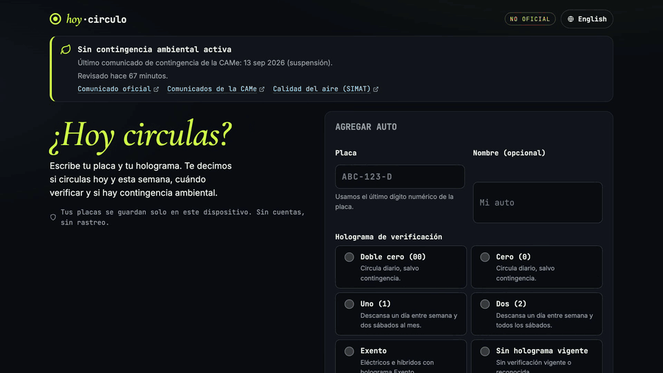
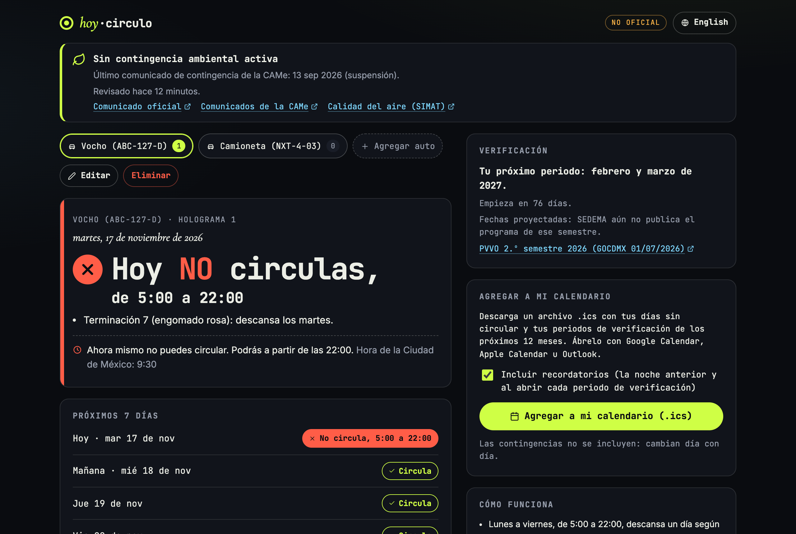
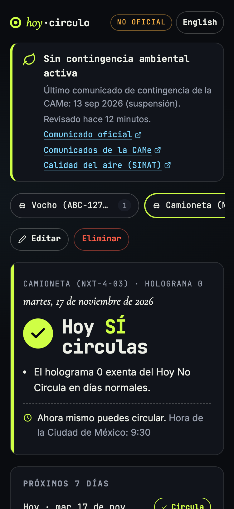
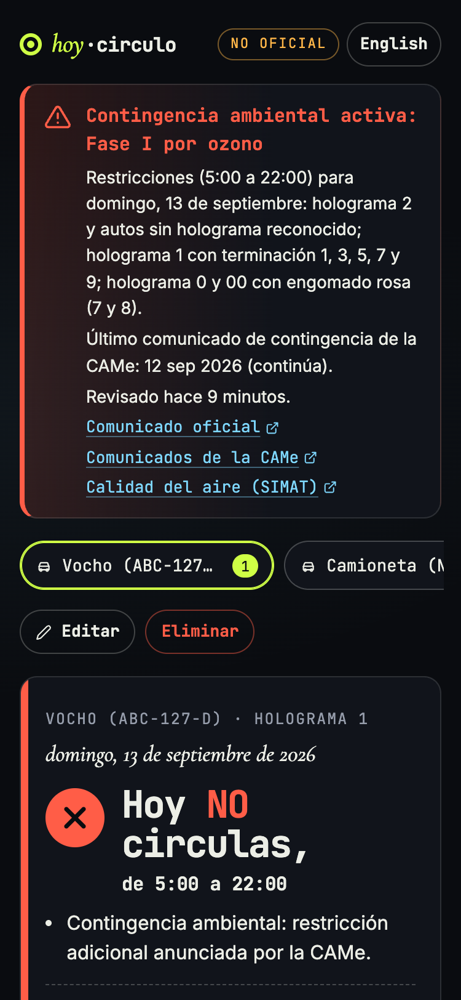
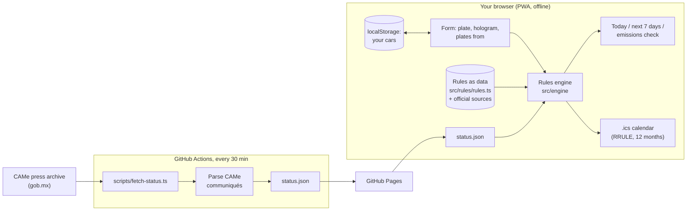

<p align="center">
  <a href="https://pivotek.mx"></a>
</p>

<p align="center">
  
</p>

<p align="center">
  <a href="https://github.com/BEG-lag/hoy-circulo/actions/workflows/ci.yml"></a>
  <a href="https://github.com/BEG-lag/hoy-circulo/actions/workflows/deploy.yml"></a>
  <a href="LICENSE"></a>
  
</p>

<p align="center"><b>English</b> · <a href="README.es.md">Español</a></p>

<!-- demo:start -->
<p align="center">
  
</p>
<p align="center"><sub>Real recording of <a href="https://beg-lag.github.io/hoy-circulo/">the live app</a> on 2026-11-17. <a href="assets/demo.mp4">MP4 version</a>.</sub></p>
<!-- demo:end -->

# hoy·circulo

**Can I drive today?** A small installable web app for drivers in Mexico City and the State of Mexico: enter your plate and emissions hologram and it tells you whether you can drive today and this week under *Hoy No Circula*, warns you about environmental contingencies, shows your next emissions check window, and exports everything to your phone's calendar (.ics).

**Use it:** https://beg-lag.github.io/hoy-circulo/ (Spanish by default, English toggle).

> **Unofficial. Check the official announcements of SEDEMA and CAMe.** This is an independent tool, not a government service, and it is not legal advice. When an official notice says something different, the notice wins.

| Desktop | Phone | Contingency (13 Sep 2026, replayed) |
|---|---|---|
|  |  |  |

## What it does

- **Big, clear answer.** "Hoy SÍ circulas" or "Hoy NO circulas, de 5:00 a 22:00", with the reason (sticker color, Saturday rule, out-of-area plates, contingency) and what it means right now in Mexico City time.
- **The next 7 days**, including Saturdays by week of the month, 5th Saturdays and holidays (the program does not stop on holidays unless there is an official notice).
- **Environmental contingency banner** fed by the official CAMe communiqués (see [live status](#live-contingency-status)). When the status cannot be confirmed, it says so and links to the official announcement instead of guessing.
- **Next emissions check window** by sticker color, with projected dates clearly marked when SEDEMA has not published that semester's program yet.
- **Add to my calendar:** one .ics file with recurring no-drive events (RRULE) and the emissions check windows for the next 12 months, with optional reminders. Works with Google Calendar, Apple Calendar and Outlook.
- **Several cars**, saved only in your browser (localStorage). No accounts, no server, no analytics, no cookies, no third-party requests (fonts are self-hosted).
- **Installable PWA** that works offline after the first visit.
- **Accessible:** labelled controls, keyboard friendly, visible focus, color never carries meaning alone (every status has text and an icon), no horizontal scroll at 375 px, respects `prefers-reduced-motion`.

## How it works



The rules are plain data with their sources ([`src/rules/rules.ts`](src/rules/rules.ts), [`src/rules/sources.ts`](src/rules/sources.ts)). The engine ([`src/engine/hnc.ts`](src/engine/hnc.ts)) only reads that data, so a new verification program or a suspension notice is a data change, not a code change.

## The rules, in short

Every rule was read in the official documents on 17 Nov 2026. Articles, quotes and what could not be verified are in **[docs/reglas.md](docs/reglas.md)** (Spanish).

| Rule | Source |
|---|---|
| Monday to Friday, 5:00 to 22:00, one day by last plate digit: 5-6 Mon, 7-8 Tue, 3-4 Wed, 1-2 Thu, 9-0 Fri | [Decreto HNC, GODF 19/06/2014](https://www.sedema.cdmx.gob.mx/storage/app/media/programas/hoy-no-circula/decreto-programa-hoy-no-circula-segundo-semestre-2016.pdf), tables 1-2 |
| Hologram 1: odd endings rest on the 1st and 3rd Saturday, even endings on the 2nd and 4th; a 5th Saturday is free | Decreto HNC 2014, table 1; [PVVO 2nd half 2026, GOCDMX 01/07/2026](https://proyectos.sedema.cdmx.gob.mx/datos/storage/app/media/gacetas/GOCDMX_26-07-01_DGCA.pdf), 14.2.I |
| Hologram 2 and cars without a valid hologram: every Saturday | Decreto HNC 2014, table 2; PVVO 2026, 14.2.II and V |
| Holograms 00, 0, Exento (electric/hybrid), disability plates, Pase Turístico: exempt on normal days | PVVO 2026, 14.1 |
| Out-of-area or foreign plates without a recognized hologram: like hologram 2, plus Monday to Friday 5:00 to 11:00 | Decreto HNC 2014, V and table 3; PVVO 2026, 14.2.IV |
| Holidays: the program still applies unless an official notice suspends it | Decreto HNC 2014, XI |
| Where: Mexico City's 16 boroughs and 18 municipalities of the State of Mexico | [CAMe guide](https://www.gob.mx/cms/uploads/attachment/file/878737/Guia_del_Programa_HNC_02_enero_2024.pdf) |
| Emissions check: two months per semester by sticker color | [PVVO 1st half 2026](https://proyectos.sedema.cdmx.gob.mx/datos/storage/app/media/gacetas/GOCDMX_26-01-02_DGCA.pdf) and 2nd half 2026, table 1 |
| Contingency Fase I/II: hologram 2 all; hologram 1 odd or even (alternating, per communiqué); holograms 0/00 by the day's sticker color | [Programa de Contingencias, GOCDMX 28/05/2019](https://data.consejeria.cdmx.gob.mx/portal_old/uploads/gacetas/25a1ef7295458ade0faad3daebb31f05.pdf), table 3 |

## Live contingency status

There is no official API or working RSS feed for contingencies. The most stable official source found is the **[CAMe press archive on gob.mx](https://www.gob.mx/comisionambiental/es/archivo/prensa)**, where CAMe publishes every activation, follow-up and suspension with a fixed template.

- A scheduled GitHub Action ([`deploy.yml`](.github/workflows/deploy.yml)) runs every 30 minutes all year (in 2026 there were contingencies in March, April and September), reads the latest communiqués with [`scripts/fetch-status.ts`](scripts/fetch-status.ts), writes `status.json` and redeploys the site. When the status changes, the file is also committed, so the history is an audit log.
- The parser extracts, per day, which holograms and plate endings cannot drive. Anything it cannot read stays empty and the app says "check the communiqué".
- The app distrusts the file when it is older than 3 hours, when the last fetch failed, or when an active contingency has had no new bulletin for 36 hours. In those cases it shows "We could not confirm whether there is an environmental contingency" with links to CAMe and [aire.cdmx.gob.mx](http://www.aire.cdmx.gob.mx/).
- The parser is tested against trimmed copies of real 2026 communiqués in [`test/fixtures`](test/fixtures).

## Development

Requires Node 22.18 or later (TypeScript runs natively in the scripts).

```bash
npm ci
npm run dev          # http://localhost:5173/hoy-circulo/
npm test             # 101 tests (Vitest)
npm run typecheck && npm run lint && npm run check:dashes
npm run build        # static site in dist/
npm run status       # fetch the live CAMe status into public/status.json
npm run screenshots  # README screenshots + smoke checks (uses local Google Chrome; set CHROME_PATH)
```

The tests include an exhaustive matrix (every hologram x plate origin x digit x day of 2026 and 2027, checked against the official tables restated by hand), Saturdays by week of the month including 5th Saturdays, holidays and suspension notices, contingency overrides, time-of-day edges (4:59, 5:00, 10:59, 11:00, 21:59, 22:00) in Mexico City time, and the .ics export parsed and expanded with [ical.js](https://github.com/kewisch/ical.js) and compared day by day with the engine.

```
src/rules/         rules as data + official sources
src/engine/        Hoy No Circula, verification, plate parsing, dates
src/contingency/   status.json schema and CAMe communiqué parser
src/ics/           iCalendar export
src/app/           UI (vanilla TypeScript), i18n, storage
scripts/           status fetcher, screenshots, icons, em dash check
docs/reglas.md     every rule with its article and link
```

### Updating the rules

Each semester SEDEMA publishes a new verification program in the Gaceta Oficial. Add it to `src/rules/sources.ts` and `RULES.verification.publishedPrograms`, check whether table 1 or section 14 changed, run `npm test`, and update [docs/reglas.md](docs/reglas.md). Official suspension notices go in `RULES.suspensions`.

## Limitations

- Private cars only. Taxis, public transport, freight and motorcycles have their own rules and are not modeled.
- 2027 emissions check dates are projections until SEDEMA publishes the program; the State of Mexico calendar was not verified in its own official gazette (the app says so).
- For plates with two numeric groups, the 2014 decree and the 2026 verification program describe the digit differently; the app asks you to confirm with your sticker color.
- The live contingency status depends on CAMe publishing on gob.mx and on the page keeping its format. GitHub may delay scheduled runs, and disables them after 60 days without repository activity.
- The Toluca and Santiago Tianguistenco metropolitan programs are not covered.

## Disclaimer

Unofficial. Check the official announcements of SEDEMA and CAMe. This project is informational, is not affiliated with any government, and does not constitute legal advice. Rules can change at any time by official notice.

## Author

**Benjamín Esponda García**, a lawyer in Mexico City who builds with AI.
[pivotek.mx](https://pivotek.mx) · [AI portfolio](https://github.com/BEG-lag/portafolio-ia) · [GitHub](https://github.com/BEG-lag)

## License

[MIT](LICENSE). Fonts: JetBrains Mono, Inter and Cormorant Garamond (SIL Open Font License), self-hosted via Fontsource.
